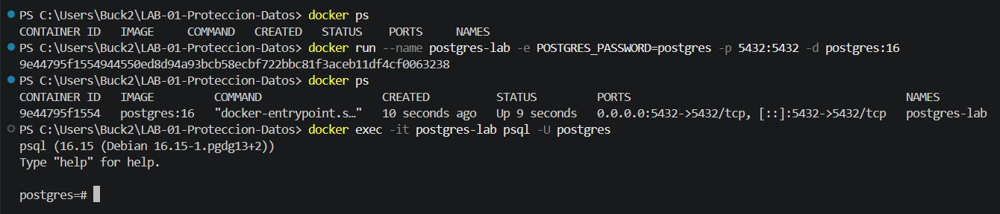

# Informe LAB-01: Protección y Privacidad de Datos
**Asignatura:** Gestión de Seguridad y Desempeño de Bases de Datos  
**Alumno:** Zamora Serrano Irvin Donovan  
**Grupo:** 4-3  
**Motor:** PostgreSQL 16  

---

## 1. Clasificación de Datos (Actividad 1)

### Matriz de Clasificación de Atributos
| Campo | ¿Identifica directamente? | ¿Puede contribuir a identificar? | ¿Requiere protección? | Justificación Técnica |
| :--- | :---: | :---: | :---: | :--- |
| `id` | No | Sí | No | Llave primaria secuencial interna. Por sí sola no identifica al titular salvo vinculación con datos personales. |
| `nombre` | Sí | Sí | Sí | Identificador directo principal de la persona física. |
| `correo` | Sí | Sí | Sí | Identificador directo que suele contener nombres o apellidos y el dominio institucional/personal. |
| `telefono` | Sí | Sí | Sí | Identificador directo vinculado unívocamente a una persona física. |
| `rfc` | Sí | Sí | Sí | Identificador oficial único en México que expone fecha de nacimiento e iniciales del titular. |
| `edad` | No | Sí | Sí | Cuasi-identificador. En combinación con ubicación geográfica reduce significativamente el grupo de búsqueda. |
| `ciudad` | No | Sí | Sí | Cuasi-identificador demográfico. |
| `codigo_postal` | No | Sí | Sí | Cuasi-identificador geográfico de alta resolución espacial. |
| `fecha_alta` | No | Sí | Bajo | Metadato temporal de registro; en correlación temporal con otros eventos podría actuar como cuasi-identificador. |

### Respuestas a Preguntas de Clasificación
1. **¿Qué campos identifican directamente a una persona?**  
   `nombre`, `correo`, `telefono` y `rfc`.
2. **¿Qué campos no identifican por sí mismos pero podrían contribuir a hacerlo?**  
   `edad`, `ciudad`, `codigo_postal` y `fecha_alta` (cuasi-identificadores).
3. **¿Qué combinación de campos podría incrementar el riesgo de reidentificación?**  
   La combinación de `edad` + `ciudad` + `codigo_postal`. Por ejemplo, una persona de 41 años ubicada en la ciudad de Culiacán con código postal 80000 limita drásticamente la población, facilitando la reidentificación mediante cruce de datos públicos.
4. **¿Todos los datos que deben protegerse son necesariamente datos personales sensibles desde el punto de vista jurídico?**  
   No. Los datos personales ordinarios (como nombre o correo) requieren protección bajo los principios de minimización y privacidad, pero no son jurídicamente datos sensibles (los cuales abarcan salud, biometría, ideología o religión). Sin embargo, su exposición sigue representando un riesgo de seguridad de la información.

### Evidencia de Ejecución

---

## 2. Enmascaramiento (Actividad 2)

### Descripción de la Implementación
Se implementó una vista restringida (`v_clientes_soporte`) para ocultar parcialmente los atributos sensibles (`correo`, `telefono`, `rfc`) utilizando funciones de cadena de PostgreSQL (`CONCAT`, `LEFT`, `RIGHT`, `SUBSTRING`). Se creó el rol `soporte` con atributo `NOLOGIN` y se restringió el acceso directo a la tabla `public.clientes`.

### Evidencias del Proceso

### Respuestas a Preguntas de Enmascaramiento
1. **¿Qué información continúa existiendo en la tabla original?**  
   Los datos sin alterar (valores en texto plano de correo, teléfono y RFC) permanecen intactos dentro de la tabla `public.clientes`.
2. **¿Qué información puede visualizar el usuario soporte?**  
   Únicamente los datos parciales o enmascarados: los 2 primeros caracteres del correo seguidos de `*****` y el dominio, los últimos 4 dígitos del teléfono y los últimos 4 caracteres del RFC.
3. **¿Por qué no es suficiente ocultar los datos únicamente en la aplicación?**  
   Porque la seguridad basada solo en frontend o aplicación ignora ataques directos a la base de datos, intercepción de tráfico, inyecciones SQL o accesos por herramientas cliente (como `psql` o DBeaver), enviando los datos reales por la red.
4. **¿Qué ocurriría si soporte tuviera acceso directo a clientes?**  
   Se violaría el principio de mínimo privilegio, permitiendo que un operador del área de soporte exfiltre o consulte información personal sensible que no necesita para realizar sus tareas.

---

## 3. Seudonimización y Separación de Funciones (Actividades 3 y 4)

### Descripción Técnica
Se creó una arquitectura segregada por esquemas:
- Esquema `pii`: Contiene la tabla de correspondencia `pii.mapa_cliente` que relaciona un `UUID` genérico (token) generado con `pgcrypto` con el `cliente_id` real.
- Esquema `analitica`: Contiene el conjunto de datos desacoplado de identificadores directos.
- Rol `analista`: Tiene acceso exclusivo de lectura sobre `analitica.clientes`, pero su acceso está expresamente denegado sobre `pii.mapa_cliente` y `public.clientes`.

### Evidencias de Permisos

### Respuestas a Preguntas
1. **¿Qué ocurriría si analista pudiera consultar también `pii.mapa_cliente`?**  
   Se rompería la seudonimización. El analista podría ejecutar un `JOIN` entre `analitica.clientes` y `pii.mapa_cliente`, recuperando la identidad completa de los titulares.
2. **¿Qué principio de seguridad se está aplicando al separar ambos accesos?**  
   El principio de **Separación de Funciones** (*Separation of Duties*) y el principio de **Mínimo Privilegio**.
3. **¿Por qué la seudonimización no equivale a anonimización?**  
   Porque la seudonimización es **reversible**: los datos siguen vinculados al titular mediante la tabla de correspondencia protegida. En la anonimización, esa reversibilidad es técnicamente inviable.
4. **¿Qué información permite volver a relacionar el token con una persona?**  
   La tabla de correspondencia `pii.mapa_cliente` que almacena la paridad `(token UUID <-> cliente_id)`.

---

## 4. Anonimización y Riesgo de Reidentificación (Actividades 5 y 6)

### Aplicación de Técnicas
Se utilizaron técnicas de generalización y agregación en PostgreSQL:
- **Generalización de edad:** Clasificación en rangos (`18-30`, `31-45`, `46+`).
- **Generalización geográfica:** Extracción de los 2 primeros dígitos del código postal (`LEFT(codigo_postal, 2)`).
- **Supresión de grupos pequeños:** Aplicación de la cláusula `HAVING COUNT(*) >= 5` para asegurar un umbral mínimo de k-anonimato ($k=5$).

### Respuestas del Análisis de Reidentificación
1. **¿Qué identificadores directos fueron eliminados?**  
   `nombre`, `correo`, `telefono`, `rfc`.
2. **¿Qué cuasi-identificadores permanecen?**  
   `rango_edad`, `region` (prefijo de CP).
3. **¿Qué combinaciones de atributos podrían reducir el anonimato?**  
   Combinar un rango de edad específico dentro de una región geográfica reducida con fuentes externas (como censos, registros públicos o padrones).
4. **¿Qué sucede cuando un grupo contiene pocos registros?**  
   Aumenta dramáticamente el riesgo de reidentificación por deducción o por ataques de homogeneidad.
5. **¿Qué atributos deberían generalizarse?**  
   La edad exacta y el código postal completo.
6. **¿Qué información debería suprimirse?**  
   Registros u observaciones atípicas o grupos cuyo conteo sea inferior al umbral de seguridad estipulado ($k < 5$).
7. **¿Es correcto afirmar que el conjunto de datos es "100% anónimo"? ¿Por qué?**  
   No. El anonimato absoluto no existe; siempre existe un riesgo residual de reidentificación ante ataques de vinculación (*linking attacks*) o disponibilidad de datos auxiliares futuros.

### Reto de Anonimización
- **Cambio realizado:** Incrementar la generalización unificando la región al primer dígito del CP (`LEFT(codigo_postal, 1)`) y aumentando el umbral a `HAVING COUNT(*) >= 10`.
- **Motivo:** Evitar que regiones con baja densidad poblacional permitan aislar individuos.
- **Riesgo reducido:** Minimización del riesgo de ataques de deducción cruzada.

---

## 5. Retención de Datos (Actividad 7)

### Criterios y Consultas
- **Criterio utilizado:** Política de retención basada en antigüedad de registro superior a 5 años (`fecha_alta < CURRENT_DATE - INTERVAL '5 years'`).

### Evidencias de Evaluación de Retención

### Gobernanza y Procedimiento de Eliminación
- **Información a conservar:** Registros de clientes activos o con transacciones operativas/fiscales pendientes según el marco legal aplicable.
- **Información que podría eliminarse:** Datos de clientes inactivos sin obligaciones legales vigentes que hayan superado el periodo de 5 años.
- **Controles previos a la eliminación:**
  1. Ejecución de script de pre-auditoría (`SELECT` sin `DELETE`).
  2. Aprobación formal por parte del Oficial de Privacidad / Gobernanza de Datos.
  3. Respaldo completo (*backup*) comprimido e inmutable del esquema previo al purgado.
  4. Generación de bitácora y evidencia cifrada de la depuración.
  5. Definición de procedimiento de restauración selectiva en ambiente aislado para casos de error accidental.

---

## 6. Conclusiones

- **Soporte:** Enmascaramiento dinámico a través de vistas de acceso restringido (`VIEW`), garantizando que el operador solo visualice los datos mínimos para validar la identidad sin acceder al dato real.
- **Analítica:** Seudonimización con separación estricta de esquemas y roles (`analitica` vs `pii`), manteniendo la utilidad analítica del registro sin exponer la identidad del titular.
- **Publicación de Estadísticas:** Anonimización mediante agregación, generalización en rangos y supresión de microdatos (`GROUP BY`, `HAVING COUNT(*) >= N`).
- **¿Por qué ninguna técnica sustituye al control de acceso?**  
  Porque las técnicas de transformación modifican la presentación o estructura del dato, pero si el control de acceso (*GRANT/REVOKE*, roles) no está correctamente configurado, un usuario podría eludir las vistas o capas intermedia y consultar directamente las tablas base en texto plano.

---

## 7. Preguntas de Reflexión

1. **¿Cuál es la diferencia entre enmascaramiento y seudonimización?**  
   El enmascaramiento altera la representación visual del dato (ocultando caracteres) sin alterar necesariamente cómo se almacena o procesa en origen. La seudonimización reemplaza la clave de identidad directa por un token sustituto, manteniendo la relación real en un mapa separado e inalcanzable para el usuario analítico.
2. **¿Por qué la seudonimización no significa anonimización?**  
   Porque es un proceso reversible. Mientras exista el mapa de correspondencia que permita ligar el token con la persona, el dato sigue siendo personal y recuperable bajo las condiciones adecuadas.
3. **¿Por qué eliminar nombre y RFC no garantiza que un conjunto de datos sea anónimo?**  
   Porque los cuasi-identificadores restantes (edad, ubicación, fechas) pueden combinarse entre sí o con bases de datos externas para aislar e identificar de forma unívoca a un individuo.
4. **¿Qué función tienen los cuasi-identificadores?**  
   Son atributos que, aunque individualmente no identifican a una persona, al combinarse con otros aumentan la especificidad del registro hasta reidentificar al titular.
5. **¿Por qué es importante separar el mapa de seudonimización?**  
   Para evitar que un atacante o usuario interno con permisos de consulta analítica pueda enlazar los tokens con los datos reales en una sola consulta (`JOIN`).
6. **¿Qué principio de seguridad se aplica al impedir que el analista acceda al mapa?**  
   Principio de Mínimo Privilegio y Separación de Funciones (*Separation of Duties*).
7. **¿Por qué una vista puede ser preferible a entregar acceso directo a la tabla?**  
   Permite abstraer la capa de datos original, aplicar reglas dinámicas de ocultamiento o filtrado y limitar los permisos del usuario exclusivamente a la proyección controlada de la vista.
8. **¿Qué diferencia existe entre proteger un dato para visualización y protegerlo contra acceso no autorizado?**  
   Proteger la visualización evita la exposición no deseada en pantallas o reportes interfaz. Proteger contra acceso no autorizado garantiza a nivel de motor de BD que las consultas no autorizadas sean rechazadas explícitamente (`Permission Denied`).
9. **¿Por qué la retención forma parte de la protección de datos?**  
   Porque responde al principio de minimización del almacenamiento: conservar datos innecesarios o caducos aumenta inútilmente la superficie de ataque y el impacto en caso de una fuga de información.
10. **¿Qué riesgo existe si una organización conserva información indefinidamente?**  
    Aumenta el riesgo financiero, legal y reputacional ante brechas de seguridad (*data breaches*), además de incumplir regulaciones de privacidad de datos personales.