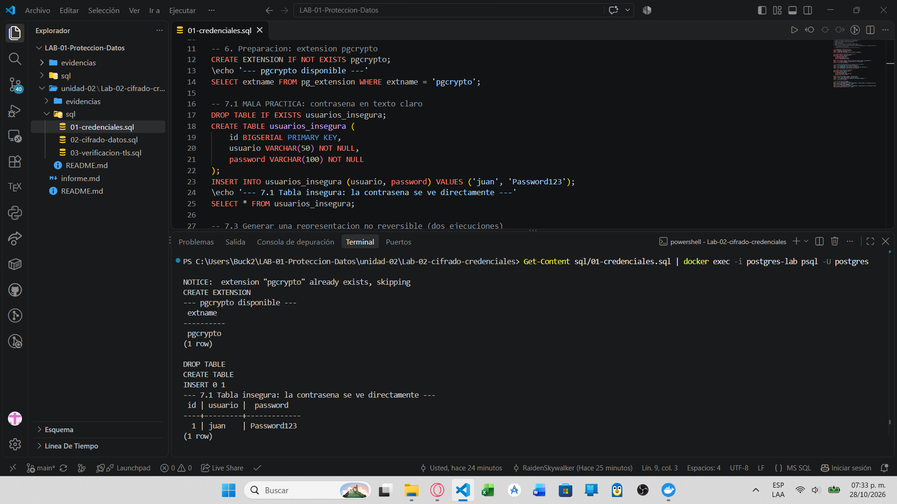
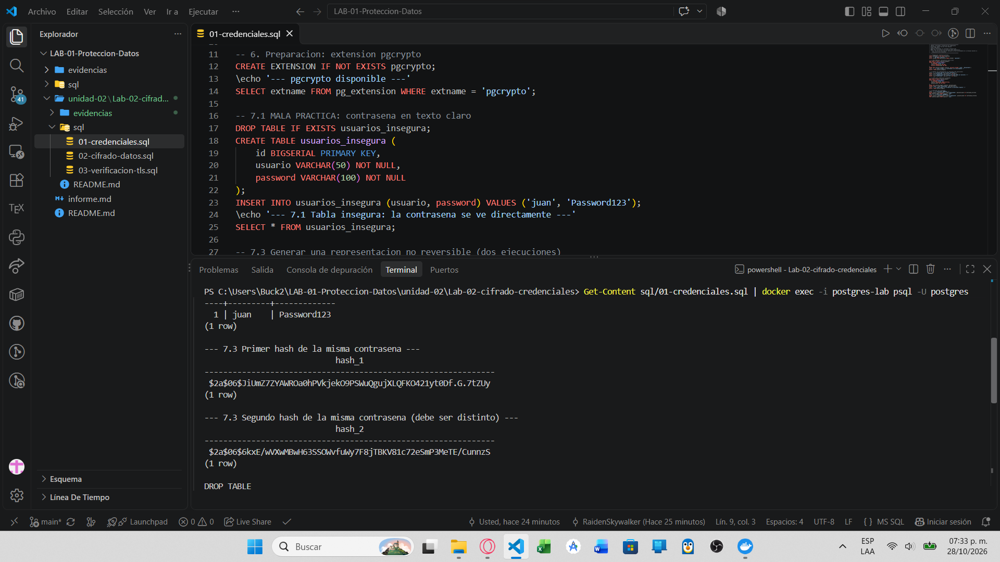
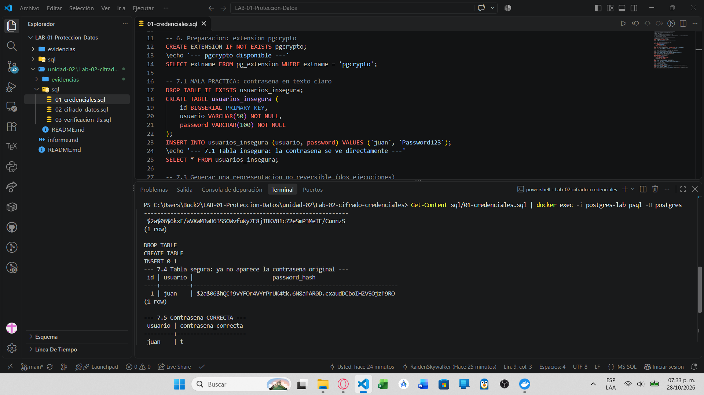
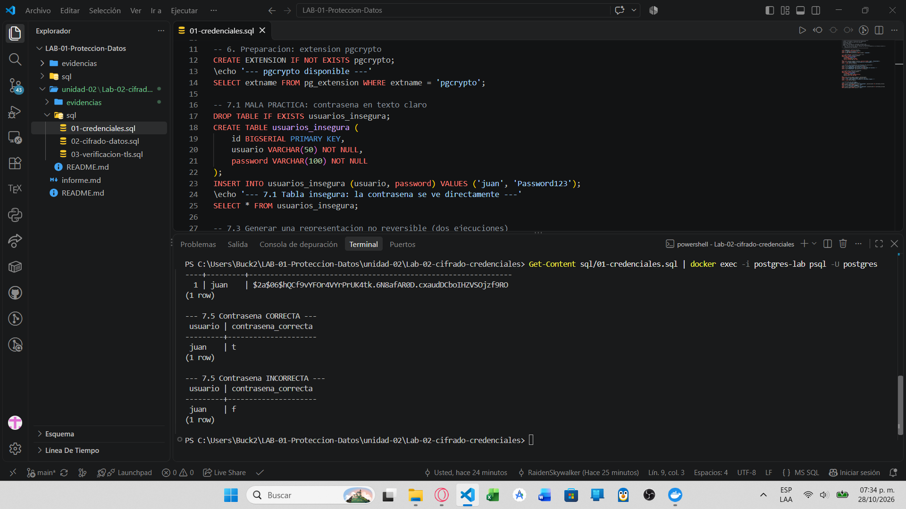

# Evidencia 01 — Protección de credenciales

**Estudiante:** Zamora Serrano Irvin Donovan | **Fecha:** 2026-10-27

## Objetivo
Comparar el almacenamiento de contraseñas en texto claro con el uso de `crypt()` y `gen_salt('bf')` (pgcrypto), y verificar una contraseña sin recuperarla.

## Comando o procedimiento
```powershell
Get-Content sql/01-credenciales.sql | docker exec -i postgres-lab psql -U postgres
```

## Resultado obtenido





**7.1 Tabla insegura (`usuarios_insegura`):**
```
(img/Actividad01/02.png)
```
**7.3 Dos hashes de la misma contraseña:**
```
(img/Actividad01/03.png)
```
**7.4 Tabla segura (`usuarios_segura`):**
```
(img/Actividad01/04.png)
```
**7.5 Verificación (`correcta e incorrecta`):**
```
(img/Actividad01/05.png)
```

## Análisis
- **¿Qué ocurriría si alguien obtiene acceso de lectura a `usuarios_insegura`?** Vería `Password123` directamente y podría suplantar al usuario; si la persona reutiliza contraseñas, también en otros sistemas. Una filtración de la base se convierte en filtración de credenciales.
- **¿Los dos hashes son iguales?** No. `gen_salt('bf')` genera una sal aleatoria distinta en cada llamada y `crypt()` la incorpora al resultado.
- **¿Qué hace `gen_salt()`?** Genera la sal aleatoria e indica el algoritmo y costo (`bf` = bcrypt).
- **¿Qué hace `crypt()`?** Calcula el hash de la contraseña usando esa sal.
- **¿Es cifrado reversible?** No. Es una derivación unidireccional: no existe función para recuperar la contraseña.
- **Contraseña correcta → `t`; incorrecta → `f`.**
- **¿Por qué no hace falta recuperar la contraseña?** Para autenticar basta recalcular `crypt(intento, hash_guardado)` (la sal viaja dentro del hash) y comparar.
- **Hash vs cifrado:** el cifrado es reversible con la clave; el hash no. Una contraseña cifrada dejaría una clave que, si se expone, revela todas las contraseñas.

## Conclusión
Las contraseñas nunca deben guardarse en texto claro ni cifradas de forma reversible: se almacenan como hash con sal mediante un algoritmo diseñado para contraseñas (bcrypt, scrypt, Argon2id).
