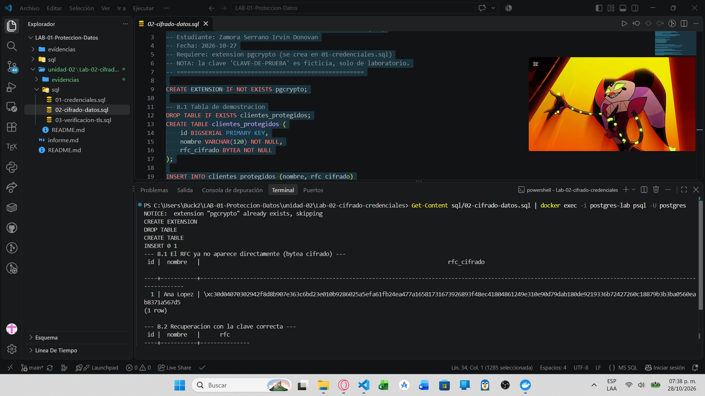
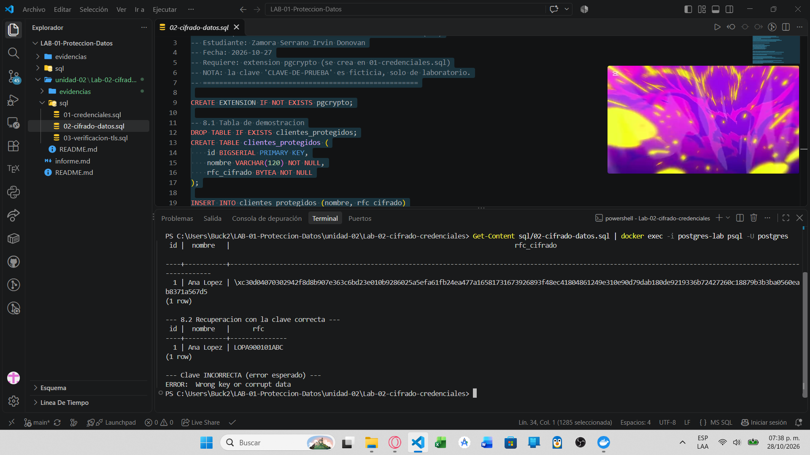
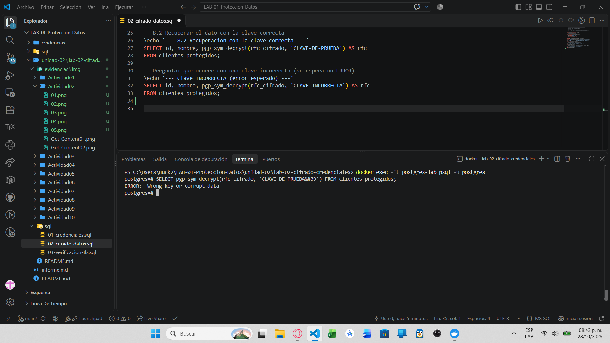

# Evidencia 02 — Cifrado de información sensible (RFC)

**Estudiante:** Zamora Serrano Irvin Donovan | **Fecha:** 2026-10-27

## Objetivo
Proteger el campo RFC con cifrado simétrico (`pgp_sym_encrypt`) y recuperarlo con `pgp_sym_decrypt`, observando qué ocurre con una clave incorrecta.

## Comando o procedimiento
```powershell
Get-Content unidad-02/Lab-02-cifrado-credenciales/sql/02-cifrado-datos.sql | docker exec -i postgres-lab psql -U postgres
```
La clave `CLAVE-DE-PRUEBA` es ficticia y exclusiva del laboratorio.

## Resultado obtenido
**8.1 Dato cifrado (`bytea`):**


**8.2 Recuperación con clave correcta:**


**Clave incorrecta (error esperado):**


## Análisis
- **`crypt()` vs `pgp_sym_encrypt()`:** `crypt()` genera un hash unidireccional para verificar contraseñas; `pgp_sym_encrypt()` es cifrado simétrico reversible para datos que luego deben recuperarse.
- **¿Cuál permite recuperar el dato original?** `pgp_sym_encrypt()`, mediante `pgp_sym_decrypt()` con la misma clave.
- **Clave incorrecta:** PostgreSQL devuelve un error (típicamente `Wrong key or corrupt data`) y no entrega el dato.
- **Problema de poner la clave en la consulta:** queda expuesta en scripts, repositorios Git, historial de `psql`, registros del servidor, capturas y documentación; quien la vea puede descifrar los datos.

## Conclusión
El cifrado protege el dato en reposo frente a quien solo lee la tabla, pero su seguridad depende por completo de la clave. Cifrar no sustituye el control de acceso ni la gestión de claves.
