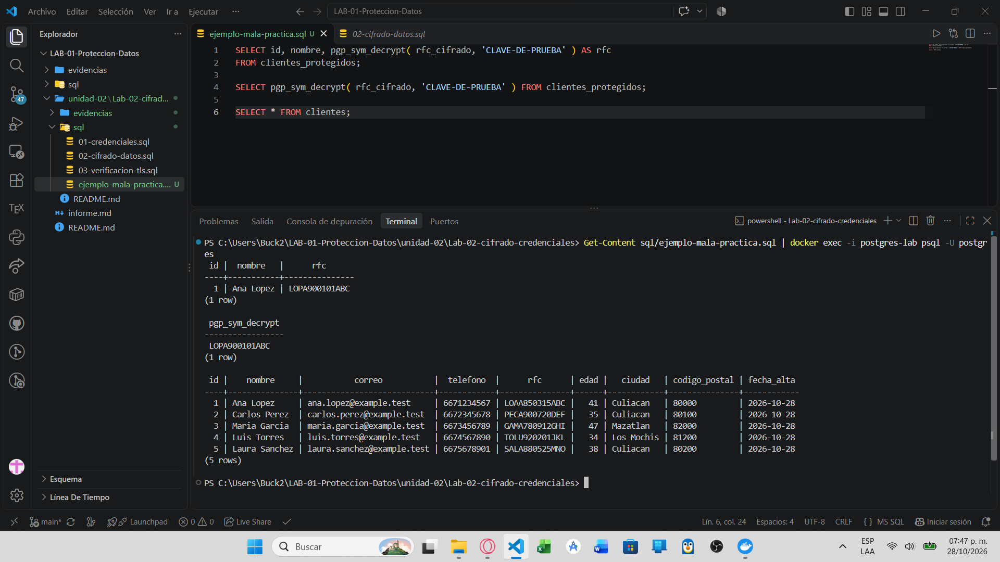
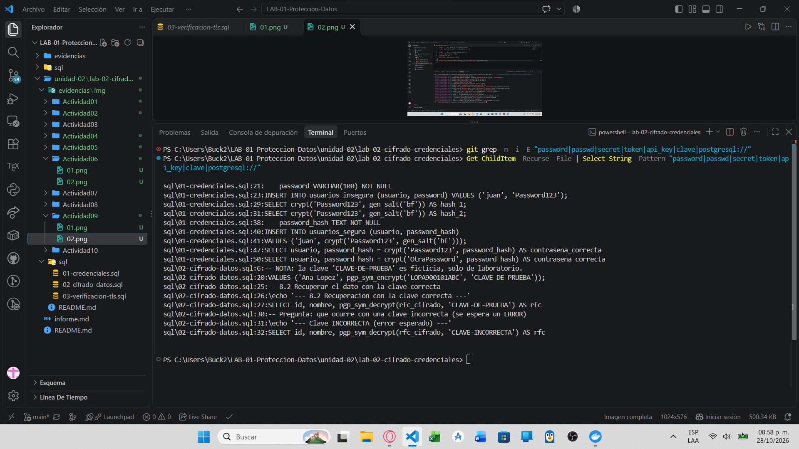

# Evidencia 03 — Gestión de claves y verificación de secretos

**Estudiante:** Zamora Serrano Irvin Donovan | **Fecha:** 2026-10-27

## Objetivo
Identificar la mala práctica de incluir una clave en un script y verificar que el repositorio no contenga secretos reales antes del commit.

## Comando o procedimiento
1. Crear temporalmente `sql/ejemplo-mala-practica.sql` (excluido en `.gitignore`):
```sql
SELECT pgp_sym_decrypt(rfc_cifrado, 'CLAVE-DE-PRUEBA') FROM clientes_protegidos;
```
2. Revisar el archivo y, al terminar, **eliminarlo** (no forma parte de la entrega).
3. Buscar secretos antes del commit (PowerShell, desde la raíz del laboratorio):
```powershell
Get-ChildItem -Recurse -File | Where-Object { $_.FullName -notmatch '\\\.git\\' } |
  Select-String -Pattern 'password|passwd|secret|token|api_key|clave|postgresql://'
```
(En Git Bash o Linux: `grep -RniE 'password|passwd|secret|token|api_key|clave' .`)

## Resultado obtenido
**Contenido del archivo de mala práctica:**


**Búsqueda de secretos:**


**Confirmación de que el archivo ya no existe:**



## Análisis
- **Si la clave fuera real y el archivo se publicara:** cualquiera con acceso al repositorio y a una copia de los datos (consulta a la tabla, respaldo, volcado) podría descifrar todos los RFC. Aunque se borre después, la clave permanece en el historial de commits. Habría que rotar la clave y recifrar los datos.
- **Hallazgos de la búsqueda:** las coincidencias corresponden a valores ficticios del laboratorio (columna `password`, `Password123`, `CLAVE-DE-PRUEBA`) y a nombres de columnas/comentarios; no hay credenciales ni claves reales.
- **Un repositorio privado no es un almacén de secretos:** reduce la exposición, pero el secreto sigue en el historial, clones, copias y a disposición de todos con acceso.

## Conclusión
Las claves deben vivir fuera del código y del repositorio (gestor de secretos, KMS o variables protegidas del entorno). La revisión previa al commit es un hábito útil, aunque una búsqueda por texto no detecta todos los secretos.
